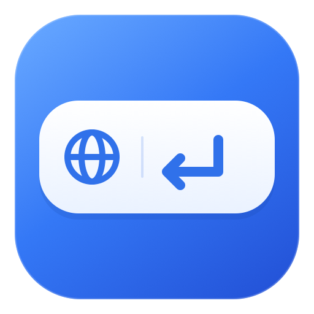
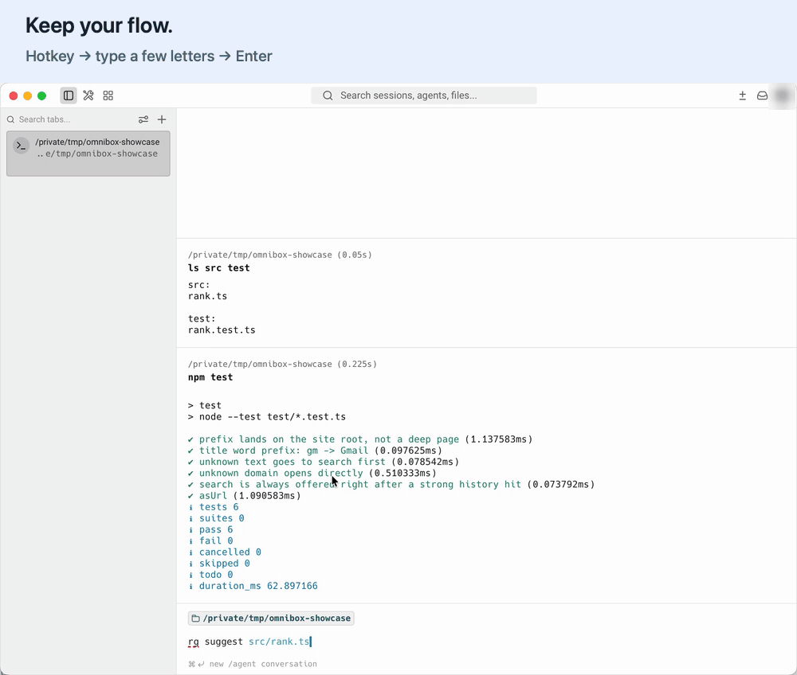
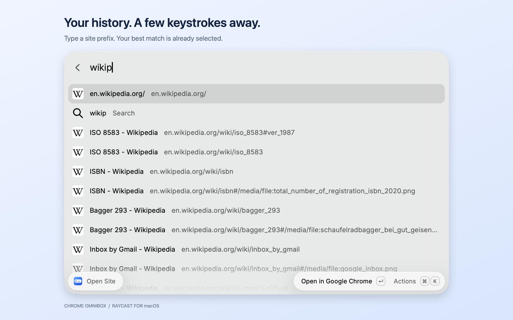
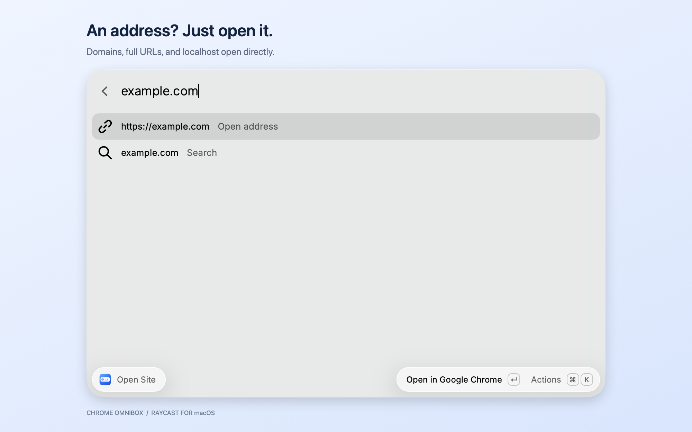
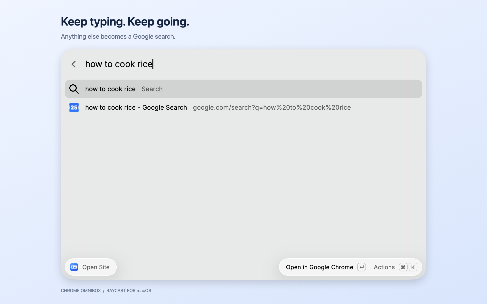

# Chrome Omnibox

Your browser's address bar, one hotkey away — in [Raycast](https://www.raycast.com).

[](https://github.com/allnightlong/raycast-chrome-omnibox/actions/workflows/ci.yml)

[](LICENSE)

<!-- Uncomment once the extension is live in the Store:
[](https://www.raycast.com/allnightlong/chrome-omnibox)
-->

Hit a hotkey from any app, type a few letters of a site you've been to, press <kbd>Enter</kbd> — it opens in your browser. No aliases, no quicklinks to maintain: everything is learned from your browser history.



Recorded with a separate Chrome demo profile and sample history.

| You type | You get |
| --- | --- |
| `you` | youtube.com |
| `cla` | claude.ai |
| `gm` | Gmail |
| `habr.com`, `localhost:3000` | opened directly |
| `how to cook rice` | Google search |

## Features

- **One step.** The best guess is already selected; <kbd>Enter</kbd> does the right thing. Web search is always the next item.
- **Ranks like an address bar.** Address prefix beats a word match beats a substring; ties go to the sites you visit and type most, and visited recently. Pages of one site collapse into the site itself, so `cla` lands on `claude.ai/`, not on some old chat.
- **Zero config.** Works with Chrome and every other Chromium browser: finds each installed one and profile and uses the one whose history was written most recently — the one you actually use.
- **Private.** History and favicons are read from the browser's local databases. Nothing is sent anywhere.

## Screenshots

Captured in Raycast on macOS with public-site queries.

| History | Direct address | Web search |
| --- | --- | --- |
| [](media/screenshot-history.png) | [](media/screenshot-address.png) | [](media/screenshot-search.png) |

## Supported browsers

| | Windows | macOS |
| --- | :---: | :---: |
| Google Chrome (Stable, Beta, Dev, Canary), Chromium | ✓ | ✓ |
| Microsoft Edge, Brave, Vivaldi, Yandex Browser | ✓ | ✓ |
| Opera, Opera GX, Comet, Helium, Cốc Cốc | ✓ | ✓ |
| Arc, Dia, ChatGPT Atlas, Iridium | | ✓ |
| 360 Speed (X), QQ Browser, Sogou Explorer | ✓ | |

Missing yours? Open an issue with the browser name and its `chrome://version` → *Profile Path*.

## Recommended setup: launch directly with a hotkey

Assign a **global hotkey to Open Site itself**. This opens the extension from any app and bypasses Raycast's main search dialog: **hotkey → type a site or address → Enter → you're there**. No need to open Raycast and find the command first.

1. Open **Raycast Settings → Shortcuts**, search for **Open Site**, and choose the command under **Chrome Omnibox**. In older Raycast versions, use **Extensions → Chrome Omnibox → Open Site**.
2. Click **Record Hotkey** and press your chosen shortcut.
3. Return to any app, such as Warp, and try it.

Suggested macOS shortcuts:

| Shortcut | When to choose it |
| --- | --- |
| <kbd>⌃</kbd> + <kbd>⌥</kbd> + <kbd>⌘</kbd> + <kbd>L</kbd> | Recommended starting point, used in the showcase: L for Link, separate from the usual Space-based launchers. |
| Double-tap right <kbd>⌥</kbd> | A one-finger alternative if another command isn't already using it. |
| <kbd>Hyper</kbd> + <kbd>L</kbd> | If you already have a Hyper key configured; L for Link. |

Keep the command's hotkey separate from Raycast's launcher hotkey. <kbd>⌥</kbd> + <kbd>Space</kbd> opens Raycast by default; macOS uses <kbd>⌘</kbd> + <kbd>Space</kbd> for Spotlight, <kbd>⌃</kbd> + <kbd>Space</kbd> and <kbd>⌃</kbd> + <kbd>⌥</kbd> + <kbd>Space</kbd> for input-source switching, and <kbd>⌃</kbd> + <kbd>⌘</kbd> + <kbd>Space</kbd> for emoji. Check your own app shortcuts too; no combination is universally free.

On Windows, try <kbd>Ctrl</kbd> + <kbd>Alt</kbd> + <kbd>Space</kbd> if it is free in your setup.

See [Raycast's hotkey guide](https://manual.raycast.com/command-aliases-and-hotkeys) and [Apple's shortcut reference](https://support.apple.com/en-us/102650).

## Development

```bash
npm install
npm run dev     # load into Raycast in development mode
npm test        # ranking tests (node:test, no Raycast needed)
npm run lint
npm run build
```

**Windows Raycast, toolchain in WSL:** `npm run dev:win` builds into the Windows profile's `.config\raycast\extensions\` and Windows Raycast picks it up in its Development section — no Node needed on Windows.

**Publishing:** `npm run publish` locally, or Actions → *Publish to Raycast Store* → Run workflow (needs repo secret `RAYCAST_PUBLISH_TOKEN`: classic PAT with `repo` scope). Either way it opens or updates the PR in [raycast/extensions](https://github.com/raycast/extensions).

## License

[MIT](LICENSE)
